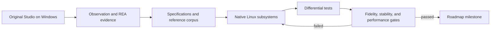

# Roadmap: Native Roblox Studio for Linux

**Status:** initial plan, based on research conducted on 2026-10-28
**Goal:** port Roblox Studio to an application that runs natively on Linux, with functional compatibility and performance measured against equivalent workflows in original Studio. The project should also seek to outperform the original when a proven optimization preserves behavior.

## Assumptions and boundaries

- The user states that they are authorized to analyze, modify, and port Studio/the engine, and that Roblox permits this kind of modification. This authorization is a project assumption; do not ask for confirmation again.
- The solution must not use Wine, Proton, or Vinegar as a runtime, backend, dependency, or fallback. The final product must run as a native Linux program.
- Studio source code is not in this repository. The plan is an independent implementation guided by observed behavior, technical specifications, REA, and differential tests. REA provides evidence; it does not automatically generate a port.
- Do not access or research Roblox terms, rules, policies, legal pages, moderation, or other normative materials. Technical documentation for APIs, the engine, and formats may be consulted when needed.
- The repository currently contains no product code, build system, benchmarks, or test corpus. Therefore, phases are ordered by dependency, without calendar estimates; estimates will be made after the Phase 0 technical spikes.
- The long-term goal is full coverage of the Studio workflows inventoried by this project. Intermediate releases may have narrower scope, but must clearly state what works, what is partial, and what does not exist yet.
- This is a distributable product for Linux creators beyond the repository owner, not a personal setup. Do not hard-code author-specific paths, usernames, credentials, account IDs, device names, display settings, or hardware assumptions; use runtime discovery, XDG Base Directory conventions where appropriate, and documented user configuration.

## Definition of success

Do not call the project a functional port just because it opens a window or displays a scene. Each milestone must deliver a usable vertical slice—open or create a project, edit it, save it, reopen it, and verify the result—with approved compatibility and performance criteria.

The port may be announced as complete only when:

1. Every inventoried user workflow has an explicit status and acceptance test.
2. All critical workflows pass on native Linux.
3. Handling supported projects does not silently lose data.
4. The published performance, stability, and platform matrix has passed.
5. Missing or partial features are identified; do not use “compatible” to mean “opens some projects.”
6. Original Studio has served as a behavior reference and baseline without limiting the implementation to repeating its internal choices or inefficiencies.

## Initial feature priorities

Maintain a `compatibility-matrix.csv` or equivalent from Phase 0 onward. Each row represents a workflow or capability, not just an API class. Minimum fields: identifier, priority, target version, evidence, implementation, test, status, limitations, and owner.

| Priority | Initial scope | Acceptance criteria |
|---|---|---|
| **P0 — local core** | Launch the app; create/open/save/close a local project; navigate the hierarchy; select and edit common properties; edit, analyze, and save Luau scripts; interactive viewport; undo/redo; basic local playtest. | Every workflow passes end to end on Linux and does not damage the source file. |
| **P1 — production** | Binary and XML files, larger scenes, transform tools, debugging, assets, terrain, animation, audio, preferences, autosave, import/export, and selected plugins. | Support is measured by feature, format, and fixture; no compatibility claim without a test. |
| **P2 — advanced parity** | Collaboration, account and remote services, publishing, advanced asset integration, more complex plugins, and other workflows found in the inventory. | Each integration has a technical contract, failure handling, and its own tests; report its status separately. |

These are proposed priorities. Phase 0 must confirm them through a workflow inventory and creator impact. The technical Engine API index already lists hundreds of classes and enums; prioritize by workflow and observed usage rather than implementing every class in alphabetical order.

## Repository ownership and GitHub automation

- The primary agent owns technical repository work end to end: architecture and stack decisions, repository structure, cleanup, dependency management, justified removal of dead code, quality gates, builds, benchmarks, documentation, GitHub workflows, and atomic commits. Do not hand routine repository or engineering operations to the user.
- Keep the repository maintainable from the beginning: establish ignore rules, formatting conventions, dependency and license inventory, documentation layout, and architecture decision records as they become relevant. Remove code or dependencies only after confirming they are unused and the applicable quality gates still pass.
- Build CI incrementally in the .github/workflows directory. Start with checks that apply to the current repository, then add formatting, linting, tests, native Linux builds, and packaging checks as the stack and product code are introduced. Run relevant checks for pushes and pull requests, and make failures visible before integration.
- Keep workflows reproducible and maintainable: pin third-party actions to reviewed immutable revisions, grant only the permissions each job needs, avoid exposing secrets to untrusted pull-request code, and cache dependencies with keys tied to lockfiles and toolchain versions.
- Add dependency update, vulnerability, license, and secret-scanning automation when supported by the chosen stack and GitHub configuration. Triage its findings and fix or document them; do not let automated updates bypass review or quality gates.
- Use CI runners only for claims they can verify. Generic hosted Linux runners can check software builds and headless tests; GPU, driver, Wayland/X11, and desktop integration coverage must use suitable labeled hardware or recorded manual runs.
- The primary agent reviews every agent- or subagent-produced pull request and full diff, checks the relevant workflows and quality gates, and decides whether to merge, request changes, or reject it. Configure required status checks and main-branch protection where repository permissions allow; if they are unavailable, document and follow an equivalent review gate.
- Make GitHub Releases the public distribution channel. Publish native, downloadable Linux artifacts for every supported Linux distribution and architecture, alongside source archives, checksums, dependency/license metadata, and clear release notes. This project is Linux-only: Windows and macOS are permanently outside its target platforms. Do not add builds for them or use Wine, Proton, or Vinegar.

## Phases and gates

### Phase 0 — baseline, scope, and architecture decisions

**Goal:** replace assumptions with a measurable target before building expensive subsystems.

- Build the Studio workflow inventory in `docs/compatibility/`, with P0/P1/P2 priority, steps, initial state, expected result, and dependencies.
- Pin a version of original Studio as the reference. Record SHA-256 hashes of analyzed executables, the Windows system version used as the oracle, resolution/scale, GPU, driver, and relevant settings.
- Set up reference Linux machines or sessions; target x86_64 first and choose the initial set of distributions, GPUs, and graphical sessions.
- Define a Linux-only support matrix for releases, covering supported distributions, CPU architectures, GPUs, drivers, and desktop sessions. Identify suitable Linux CI runners and the build, install, and smoke checks needed before advertising each target.
- Define the user-facing configuration surface and per-user storage locations using XDG Base Directory conventions where appropriate. Ensure the application can start from a clean user profile without files, credentials, or settings from the development machine.
- Record the original Studio baseline for equivalent workflows: cold/warm startup, open, save, switch tools, edit properties, run playtest, and navigate small, medium, and large scenes.
- Treat this baseline as a comparison and regression guard, not a performance limit. After initial measurements, select at least one frequent P0 workflow for an optimization goal beyond parity.
- Create ADRs comparing candidates for language, UI, renderer, scene storage, Luau integration, packaging, and plugin system. Do not lock in the stack before measuring a prototype with a large tree, long code, and a 3D viewport.
- Build a minimal native Linux window and a rendering spike under Wayland and X11. Include no Windows runtime.
- Audit the repository and add the initial GitHub Actions workflow for documentation and repository checks. Expand it with the chosen formatter, linter, tests, and native Linux build as those tools and code are introduced; define required checks for integration where GitHub settings permit.
- Create `docs/decisions/`, `docs/research/`, `tests/fixtures/`, and `benchmarks/` when the code structure begins.

**Exit gate:** P0/P1/P2 scope reviewed; reproducible baseline; stack ADRs approved; prototype opens and renders natively in reference Linux environments; initial repository checks pass in GitHub Actions; no unresolved major architectural blocker without a plan.

### Phase 1 — REA lab and behavioral specification

**Goal:** make REA usage repeatable and turn findings into traceable evidence.

**Execution status (2026-10-28):** the initial REA/host audit is documented, but this phase's gate has not passed. The current NixOS host is outside REA's documented Linux support boundary, and no Studio reference installation is accessible. See [the REA lab audit](docs/research/phase-1-rea-lab.md) and [the P0 workflow investigation plan](docs/research/phase-1-p0-workflow-plan.md).

- Configure REA and a native provider on the Linux host. Record REA, provider, and target versions and hashes in every report.
- Inventory the Studio installation and binaries; identify components, dependencies, data files, strings, exports, and areas that remain unknown.
- Investigate one question at a time. Follow an observable action through its implementation: input → function/caller → changed state or data → visible result.
- Do not treat pseudocode as original source. Check instructions, callers/callees, constants, references, and observed behavior; classify every claim as observation, interpretation, inference, or unknown.
- Create investigation notes for the main P0 workflows, with REA calls, evidence, limitations, version, and ways to refute the hypothesis.
- Use the native Windows installation of Studio as the oracle for observation and comparison. The Linux implementation remains independent.

**Exit gate:** every P0 workflow has a reproducible description, expected result, confidence level, and at least one planned differential test. Remaining questions are recorded rather than presented as facts.

### Phase 2 — data model and project formats

**Goal:** read and save projects without silent data loss before connecting the UI and runtime.

- Prototype `rbx-dom` as a candidate: it is written in Rust and has serializers for `rbxl`, `rbxm`, `rbxlx`, and `rbxmx`, but its own coverage table shows types that are not yet implemented. Validate gaps and license before adopting it, wrapping it, or replacing parts.
- Define an `Instance`/tree model, identity, references, properties, types, attributes, and unknown data. Preserve fields the app does not yet understand whenever the format allows it.
- Implement reading first, then atomic writes with backup and recovery. An interrupted save must not leave the previous file truncated.
- Create a versioned fixture corpus with simple cases, cross-references, optional properties, unknown data, large files, and malformed files. Each fixture must state its origin and hash; do not include private user data.
- Test parse → serialize → parse for semantic equality and compare generated files with original Studio. Identical bytes are desirable when output is deterministic, but semantic equality and data preservation are the primary gate.
- Record coverage by format, property type, class, and read/write behavior. Explicitly reject corrupt or unsupported data when it cannot be safely preserved.

**Exit gate:** 100% of P0 corpus cases open, save, and reopen with semantic equality; no supported field is lost; no unknown field is silently lost; invalid input produces controlled errors.

### Phase 3 — Luau, reflection, and code tools

**Goal:** deliver script editing with real Luau semantics without conflating the language with Roblox Engine.

- Evaluate the official Luau runtime/compiler as an embedded dependency. Luau provides the language, compiler, VM, and embedding APIs; by itself it does not provide `Instance`, Roblox services, a scheduler, physics, or Studio behavior.
- Integrate a parser, formatter/linter where compatible, diagnostics, navigation, autocomplete, type checking, and debugging in stages.
- Build engine bindings on the data model, with tests for properties, methods, events, callbacks, coroutines, and errors.
- Separate the code editor from the VM and engine API. Allow scripts to remain editable and clearly labeled even when the full runtime is unavailable.
- Use Luau project's tests and benchmarks as the language baseline; add a corpus of authorized real scripts and compatibility fixtures.

**Exit gate:** reference Luau scripts parse/compile as expected; diagnostics have stable locations; execution does not block the UI; missing APIs produce clear errors instead of invented behavior.

### Phase 4 — desktop shell and project editing

**Goal:** build the native work experience and the first real vertical slice.

- Implement the window, documents/tabs, shortcuts, preferences, menus, and persistent layout.
- Store per-user preferences, cache, logs, and application data in appropriate XDG user-scoped locations; let users choose project paths and do not rely on fixed absolute paths.
- Deliver hierarchy/Explorer, property inspector, selection, common operations, undo/redo, and script editing.
- Open a local project, modify a property and a script, save, close, reopen, and recover the exact changes.
- Add autosave, atomic saving, an unsaved-changes indicator, failure warnings, and session recovery without overwriting the original.
- Validate focus, IME, HiDPI scaling, multiple monitors, keyboard, and accessible navigation on selected Linux desktops.

**Exit gate:** all local P0 project workflows pass E2E; no destructive command runs without confirmation or undo; a project can be reopened after a forced shutdown through the recovery path.

### Phase 5 — viewport and 3D editing

**Goal:** edit scenes in the Linux renderer with predictable latency and fidelity.

- Choose and record the renderer/graphics API based on Phase 0 ADRs; isolate the backend so the data model is not coupled to the GPU.
- Implement prioritized camera, selection/picking, transforms, gizmos, grid, materials, and lighting.
- Add asset import and viewing with size limits and recoverable errors.
- Optimize per scene: use culling, batching, incremental updates, caching, and asynchronous loading only when profiling identifies the bottleneck.
- Test Intel, AMD, and NVIDIA GPUs and Wayland/X11 sessions on declared targets. Capture crashes, shader compile hitches, frame time, and memory use.

**Exit gate:** P0 viewport workflows pass on the primary matrix; a representative scene stays within its frame-time budget; no viewport operation blocks the UI thread beyond the defined limit.

### Phase 6 — local runtime, simulation, and playtest

**Goal:** allow a local experience to be tested with predictable semantics.

- Define the boundary between the editor, DataModel, and playtest runtime; prevent editor actions from changing simulation state without an explicit rule.
- Implement the scheduler/event loop, P0 services, physics, input, animation, audio, and runtime rendering in dependency order.
- Assemble a suite of small experiences, each covering an Engine API capability and expected behavior in original Studio.
- Compare deterministic results side by side: Instance tree, values, events, output, state when pausing/resuming, and behavior when stopping playtest.
- Implement stop/cleanup, state isolation, execution limits, and error capture for problematic scripts.

**Exit gate:** the P0 reference project set starts, runs, pauses, and exits correctly; differential results pass; no playtest changes the saved file without an explicit user action.

### Phase 7 — production tools and ecosystem

**Goal:** cover P1 workflows and expand compatibility with existing projects.

- Expand support for advanced files and types; assets, terrain, animation, audio, debugging tools, and import/export.
- Evaluate plugin compatibility by category. Any compatibility claim needs API and UI tests; an unsupported plugin must fail with a clear diagnostic.
- Use Rojo and `rbx-dom` as public references for filesystem workflows, versionable scripts, and synchronization; do not confuse these tools with a complete Studio implementation.
- Maintain a versioned API index and generate property/type reports with coverage, tests, and implementation status.

**Exit gate:** all features announced as P1 have fixtures and tests; every format has documented coverage; announced plugins have passed a published compatibility matrix.

### Phase 8 — online services and collaboration

**Goal:** integrate remote workflows after local workflows and the runtime are reliable.

- Inventory authentication, asset libraries, search, sync, collaboration, cloud projects, and publishing using available technical documentation and authorized REA evidence.
- Isolate services behind testable interfaces. Use recorded responses or fakes for tests; do not mix online state with local editing.
- Handle session expiration, network failures, conflicts, retries, rate limits, and cancellation without losing local work.
- Redact tokens, cookies, private IDs, and account data from logs and fixtures.
- Do not research Roblox normative materials; the user's permission recorded in this project remains the assumption.

**Exit gate:** every online workflow has tests for success, failure, timeout, conflict, and recovery; a lost connection never deletes local changes; no secret appears in logs or reports.

### Phase 9 — stabilization, performance, and distribution

**Goal:** release only after fidelity, stability, performance, and installation metrics have passed.

- Run full regression on the corpus, hardware matrix, and announced P0/P1/P2 workflows.
- Run long sessions, repeatedly open/save, load large projects, and force shutdown during every save stage.
- Fix measured bottlenecks; attach profiles and before/after benchmarks for rendering, memory, parsing, or VM optimizations.
- Do not tune without a diagnosis. Every performance change must identify a reproducible bottleneck, causal hypothesis, profile, and before/after result; improvement indistinguishable from noise does not justify added complexity.
- Choose Linux packaging (Flatpak, distribution package, or another method) in an ADR with clear update, file permission, desktop integration, and rollback behavior.
- Complete the GitHub release workflow for every Linux distribution and architecture in the published support matrix. Build each artifact natively on Linux from a clean checkout, run its release gates, attach checksums and dependency/license metadata, and publish notes describing supported systems and limitations. Do not claim hardware coverage from runners that do not match the supported GPU and desktop matrix.
- Publish actual requirements, compatibility matrix, known limitations, crash reporting process, and release notes.
- Verify installation, first launch, configuration, update, and removal from clean Linux user profiles on the advertised distribution matrix; document data locations and migration behavior.

**Exit gate:** all P0, stability, and performance gates are green; no critical data-loss defect remains; the support matrix and limitations match what was actually tested.

## Metrics and measurement method

The numeric targets below are **initial targets**, not current measurements. Recalibrate them in Phase 0 after running original Studio and the port on the same machine, with the same data and version. If a target changes, record the reason and new baseline; do not silently relax a failed gate.

A release cannot advance to beta or 1.0 with a red release gate. A P95 regression above 10% in a P0 operation blocks the release until it is reproduced, profiled, and fixed, or accepted in an ADR with its cause and impact documented. A single noisy result calls for another measurement, not an automatic exception.

| Area | Metric | Release gate |
|---|---|---|
| Functional coverage | Workflows with status, priority, evidence, and test; P0 pass rate | 100% of P0 workflows pass; every remaining feature is explicitly marked supported, partial, or unavailable. |
| File integrity | Semantically equal round trips; supported fields lost; silent losses | 100% of P0 corpus cases pass; zero silent loss; zero corruption in save tests. |
| Reliability | Crash-free beta sessions; successful launch/open/save; open critical defects | ≥99.5% crash-free sessions across at least 200 beta sessions; 0 open critical defects; 0 reproducible data loss. |
| UI responsiveness | P95 for a common action (selection, property edit, opening a tab) | ≤100 ms on the reference project; long operations must show progress and not block input. |
| Startup and operations | P50/P95 cold/warm startup, open, and save compared with native Studio | Initially ≤1.5× the equivalent baseline; goal before 1.0: ≤1.25×. If an operation has no equivalent, define and justify its own SLO. |
| Viewport | P95 and P99 frame time in reference scenes; hitches >100 ms per minute | Initial target: 60 FPS on recommended hardware (P95 ≤16.7 ms), minimum 30 FPS on minimum hardware (P95 ≤33.3 ms); record p99 and hitches. |
| Memory/CPU | PSS/RSS at idle and with P50/P90 scenes; idle CPU after warmup; soak growth | Working memory ≤1.5× the equivalent Windows baseline before beta and ≤1.25× before 1.0; idle CPU <3% of one logical core; no continuous growth after warmup. |
| Native Linux | Builds and smoke tests by distro, GPU, and graphical session | No Windows/Wine component in the runtime; 100% of announced environments pass P0 smoke workflows. |
| User portability | Clean-profile install and launch; configuration and data-path behavior | 100% of advertised Linux environments work without author-specific files or settings; no hard-coded personal paths or credentials; user data locations and configuration are documented. |
| Optimization discipline | Performance changes with diagnosis and reproducible comparison | 100% of accepted optimizations have before/after evidence beyond measurement variation; zero speculative optimization without an identified bottleneck. |
| Build and release | Clean builds, artifacts, and reproducible dependencies for each advertised Linux distribution/architecture | Reproducible Linux x86_64 build from a clean checkout, plus passing native build/install checks for every additional advertised Linux distribution and architecture; dependencies and licenses inventoried; packages, checksums, and rollback documented. |

The parity targets in the table are maximum acceptable limits for critical workflows, not the ideal result. After Phase 0, choose a frequent P0 workflow and set a 1.0 stretch goal of at least 20% lower P95 than original Studio, if measurements confirm a safe opportunity. If no proven opportunity exists, do not add artificial optimization just to hit that number; record the result and choose another workflow.

### Optimization policy — diagnose before changing

The project may use algorithms, data layouts, caching, incremental/asynchronous loading, batching, and parallelism that differ from original Studio. These are implementation hypotheses, not automatic optimizations: each must address an observed cost and preserve workflow semantics, ordering, events, and results.

For each performance proposal, record the following in `benchmarks/` or an issue/ADR:

1. The symptom the user experiences and steps to reproduce it.
2. The machine, build, project/fixture, action sequence, and measurements before the change.
3. A profile or trace that locates the cost; do not infer the bottleneck from code appearance alone.
4. The causal hypothesis, primary metric, and secondary metrics that could get worse.
5. The result after the change, repetitions, distribution/noise, and differential tests that protect behavior.
6. The decision: keep, revert, or record an approved trade-off. If the gain does not exceed noise, revert or simplify.

An optimization does not pass if it increases throughput in a microbenchmark but worsens the full workflow, P95/P99 tail, memory use, or data integrity beyond limits. Always compare the same build mode, dataset, and hardware; save the commit and results to detect future regressions.

### Benchmark protocol

1. Record commit, build type, distro/kernel, CPU, GPU/driver, resolution/scale, graphical session, Studio oracle version, and dataset hashes.
2. Measure on the same hardware and projects. Separate cold and warm starts; run at least 5 warmups and 30 measurements per latency operation.
3. Report median, P95, P99 when sample size allows, spread, and failure rate. Do not publish only the mean or a favorable run.
4. Measure the viewport for 5 minutes per scene after warmup; include frame time, stutters, GPU use, memory, and temperature/clock where available.
5. Save versioned results in `benchmarks/results/<commit>/<environment>/`. Each optimization needs a profile and before/after comparison.
6. Use Criterion if the core is Rust or an equivalent tool suited to the chosen stack; use `perf` and GPU profiling to locate Linux bottlenecks. A microbenchmark does not replace a full experience test.

### Minimum scenario set

- Empty project: open, save, reopen, and close.
- Small P0 project: hierarchy, properties, scripts, and local playtest.
- Medium project: median files from the authorized corpus.
- Large project: 90th percentile of the corpus; if no real corpus exists yet, use a synthetic scene and label it synthetic.
- Short and long Luau scripts: analysis, autocomplete, editing, compilation, execution, and errors.
- Stress: continuous selection/transform, switch tabs, undo/redo, save under load, and repeated playtest.
- Recovery: force shutdown before, during, and after save; verify the file and recovery state.

## Testing strategy

- **Unit:** parser, serializer, Instance tree, references, types, and math operations.
- **Differential:** run the same workflow and data in original Studio natively on Windows and in the Linux port; compare observable states with stated tolerances.
- **Golden files:** versioned and hashed fixtures for formats, properties, and scripts; explicit review when the target version changes.
- **E2E:** create/open → edit → save → reopen → playtest → confirm state and logs.
- **Fuzzing:** truncated inputs, extreme lengths, unknown types, cyclic/invalid graphs, and malformed assets; the parser must safely reject or preserve them, never hang or corrupt a file.
- **Soak:** long sessions and repeated open/save/playtest to detect leaks, deadlocks, handles, and frame-rate drops.
- **GPU/desktop:** automated smoke tests where possible and recorded manual sessions for Wayland/X11 and announced drivers.
- **Regression:** no release changes file, workflow, or performance support without showing the differences in the compatibility report.

## Risks and responses

| Risk | What it looks like | Planned response |
|---|---|---|
| Large engine/API scope | Build UI without enough semantics or promise unsupported parity. | Prioritize workflows, maintain a versioned matrix, and complete vertical slices. |
| Format changes and coverage gaps | Files open but data is discarded or rewritten incorrectly. | Differential corpus, preserve unknown fields, atomic saves, and gates requiring zero silent loss. |
| Luau is not the engine | Scripts compile but depend on missing APIs, scheduler, or semantics. | Separate language, bindings, DataModel, and runtime; test each layer. |
| Poor performance on large projects | UI pauses, frame drops, growing resource use. | Measure first, use P50/P90 scenes, profile, and optimize against bottlenecks. |
| Driver and desktop variation | Crashes or inconsistent rendering across Wayland/X11 and vendors. | Published matrix, isolated renderer, documented native fallback, and redacted GPU logs. |
| Studio/engine changes | Evidence or compatibility breaks with a new version. | Pin a target version per milestone, record hashes, and maintain multi-version regression before updating the baseline. |
| Fragile remote integrations | Login/sync/publish failures threaten local data. | Defer remote work, isolate interfaces, use fakes, and always preserve local state. |
| Mixed stack and FFI | Rust/C++/UI make builds, debugging, and releases harder. | Use ADRs and measured spikes before adopting a dependency or language boundary. |

## Open technical decisions

Record each decision in an ADR before it becomes difficult to reverse:

1. **Core language and architecture:** compare integration with Luau, `rbx-dom`, UI, and ease of profiling/debugging.
2. **Desktop UI:** compare productivity for docking/editors/panels, accessibility, Wayland/X11, and resource use.
3. **Renderer:** measure throughput, frame pacing, picking, shader workflow, Intel/AMD/NVIDIA drivers, and memory use.
4. **Instance model:** typing, unknown properties, reflection database, versioning, and serialization.
5. **Plugins/extensions:** isolated process or in-process, ABI/API, crash containment, and compatibility.
6. **Distribution:** package, file access permissions, updates, and rollback.

Shared criteria: P0 functionality, measured p95/P99, PSS/RSS, quality of desktop integration, testability, dependency maturity, license, binary size, and maintenance cost.

## Research and technical sources

Research reviewed on 2026-10-28. The pages below are technical sources or public projects; no Roblox normative materials were consulted.

### REA and methodology

- [REA Native Binary Analysis](https://rea.tools/guides/native/) — an official example combining instructions, callers, and constant data; shows how an initial decompilation may omit information and how to compare an implementation against the original binary.
- [REA DX-Ball case study](https://rea.tools/showcase/dx-ball/) — a public small-scale reconstruction, comparison across thousands of inputs, and verification of compiled bytes.
- [REA Desktop Applications](https://github.com/morluto/rea/blob/main/docs/desktop-applications.md) — installation inventory with limitations and evidence; useful for mapping components before opening individual binaries.

### Engine, formats, and creator tools

- [Official Luau site](https://luau.org/) and [Luau repository](https://github.com/luau-lang/luau) — embeddable language, compiler/VM, and type system. Luau alone does not implement Roblox Engine.
- [Roblox Engine API Reference](https://create.roblox.com/docs/reference/engine) — technical reference for classes, types, enums, members, and release notes. Coverage should be indexed by version.
- [rbx-dom](https://github.com/rojo-rbx/rbx-dom) — Rust libraries for DOM/serialization; the project documents XML and binary format reading/writing and publishes an explicit per-type coverage table.
- [Roblox binary file format specification](https://github.com/RobloxAPI/spec/blob/master/formats/rbxl.md) — community specification for the binary format with references to reverse engineering efforts; use it alongside differential fixtures, not as a guarantee of complete compatibility.
- [Rojo](https://github.com/rojo-rbx/rojo) — public reference for file-based workflows, Git, scripts/models, and synchronization. The project itself identifies conversion/sync areas that still need configuration; it is not equivalent to full Studio.

### Metrics, performance, and public reconstructions

- [Google SRE: error budgets](https://sre.google/sre-book/embracing-risk/) — practice for tying releases to objective reliability metrics; adapt to a local app with gates for crashes, data loss, and workflows.
- [Criterion.rs](https://docs.rs/criterion/latest/criterion/) — statistical microbenchmarking that helps distinguish a real regression from noise; use if Rust is selected or choose an equivalent tool.
- [Linux kernel docs: perf/workload tracing](https://cdn.kernel.org/doc/html/latest/admin-guide/workload-tracing.html) — use `perf` to locate CPU use and bottlenecks on Linux.
- [REA ski-or-die reconstruction](https://github.com/tuunanet/rea-ski-or-die-reconstruction) — a public from-scratch reconstruction in Rust + SDL2, scoped to a minigame and guided by a behavioral specification.
- [hexgrab](https://github.com/iammukeshm/hexgrab) — an account of studying a small PowerToys feature with REA, checking against public source, and adding E2E tests. It is a process example on an MIT-licensed target, not evidence of broad parity.

These sources justify candidates and methods; they do not guarantee that a library is complete for Studio. Every proposed dependency must pass version, coverage, license, test, and benchmark review before entering the product.
