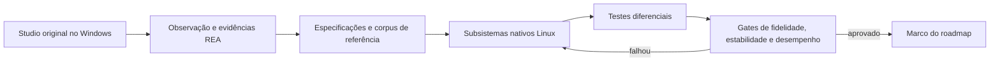

# Roadmap: Roblox Studio nativo para Linux

**Status:** plano inicial, baseado em pesquisa feita em 28/10/2026
**Objetivo:** portar o Roblox Studio para uma aplicação que execute nativamente em Linux, com compatibilidade funcional e desempenho medidos contra fluxos equivalentes no Studio original. O projeto também deve buscar superar o original em desempenho quando houver uma otimização comprovada que preserve o comportamento.

## Premissas e limites

- O usuário declara que tem autorização para analisar, modificar e portar o Studio/engine e que a Roblox permite esse tipo de modificação. Essa autorização é uma premissa do projeto; não pedir confirmação novamente.
- A solução não pode usar Wine, Proton ou Vinegar como runtime, backend, dependência ou fallback. O produto final deve executar como programa nativo de Linux.
- O código-fonte do Studio não está no repositório. O plano é uma implementação independente orientada por comportamento observado, especificações técnicas, REA e testes diferenciais. REA fornece evidências; não gera um port automático.
- É proibido acessar ou pesquisar termos, regras, políticas, páginas legais, moderação ou materiais normativos da Roblox. Consultas à documentação técnica de APIs, engine e formatos são permitidas quando necessárias.
- O repositório atualmente não contém código de produto, sistema de build, benchmarks nem corpus de teste. Portanto, as fases são ordenadas por dependência, sem estimativas de calendário; estimativas serão feitas depois dos spikes técnicos da Fase 0.
- O objetivo de longo prazo é a cobertura integral do Studio inventariada neste projeto. Entregas intermediárias podem ter escopo menor, mas devem declarar claramente o que funciona, o que está parcial e o que ainda não existe.

## Definição de sucesso

Não chamar o projeto de port funcional só porque abre uma janela ou mostra uma cena. A cada marco, deve existir uma fatia vertical utilizável — abrir ou criar um projeto, editar, salvar, reabrir e verificar o resultado — e critérios de compatibilidade e desempenho aprovados.

O port só pode ser anunciado como completo quando:

1. Todo fluxo de usuário inventariado tiver status explícito e teste de aceitação.
2. Todos os fluxos críticos estiverem aprovados em Linux nativo.
3. O tratamento de projetos suportados não perder dados silenciosamente.
4. A matriz de desempenho, estabilidade e plataformas anunciada estiver aprovada.
5. Funcionalidades ausentes ou parciais estiverem identificadas; não usar “compatível” como sinônimo de “abre alguns projetos”.
6. O Studio original tiver servido como referência de comportamento e baseline, sem limitar a implementação a repetir suas escolhas internas ou ineficiências.

## Prioridade inicial de funcionalidades

Manter um `compatibility-matrix.csv` ou equivalente desde a Fase 0. Cada linha representa um fluxo ou capacidade, não apenas uma classe da API. Campos mínimos: identificador, prioridade, versão-alvo, evidência, implementação, teste, estado, limitações e responsável.

| Prioridade | Escopo inicial | Critério de aceitação |
|---|---|---|
| **P0 — núcleo local** | Iniciar o app; criar/abrir/salvar/fechar projeto local; navegar pela hierarquia; selecionar e editar propriedades comuns; editar, analisar e salvar scripts Luau; viewport interativo; undo/redo; playtest local básico. | Cada fluxo passa de ponta a ponta no Linux e não danifica o arquivo de origem. |
| **P1 — produção** | Arquivos binários e XML, cenas maiores, ferramentas de transformação, depuração, assets, terreno, animação, áudio, preferências, autosave, importação/exportação e plugins selecionados. | Suporte medido por recurso, formato e fixture; nenhuma alegação de compatibilidade sem teste. |
| **P2 — paridade avançada** | Colaboração, conta e serviços remotos, publicação, integração avançada com assets, plugins mais complexos e demais fluxos identificados no inventário. | Cada integração tem contrato técnico, tratamento de falha e testes próprios; estado reportado separadamente. |

Os itens acima são prioridades propostas. A Fase 0 deve confirmá-las com inventário de workflows e impacto para criadores. O índice técnico da Engine API já lista centenas de classes e enums; priorizar por workflow e uso observado, não tentando implementar cada classe em ordem alfabética.

## Fases e gates

### Fase 0 — baseline, escopo e decisões de arquitetura

**Objetivo:** substituir suposições por um alvo mensurável antes de construir subsistemas caros.

- Montar o inventário de workflows do Studio em `docs/compatibility/`, com prioridade P0/P1/P2, passos, estado inicial, resultado esperado e dependências.
- Fixar uma versão do Studio original para referência. Registrar SHA-256 dos executáveis analisados, versão do sistema Windows usado como oracle, resolução/escala, GPU, driver e configurações relevantes.
- Montar máquinas ou sessões de referência Linux; declarar primeiro x86_64 e escolher o conjunto inicial de distribuições, GPUs e sessões gráficas.
- Registrar baseline do Studio original nos workflows equivalentes: início frio/morno, abrir, salvar, trocar de ferramenta, editar propriedades, executar o playtest e navegar por cenas pequenas, médias e grandes.
- Tratar esse baseline como comparação e proteção contra regressão, não como limite de desempenho. Definir após as primeiras medições pelo menos um workflow P0 frequente para meta de otimização além da paridade.
- Criar ADRs comparando candidatos para linguagem, UI, renderer, armazenamento de cena, integração de Luau, packaging e sistema de plugins. Não fixar stack antes de medir um protótipo com árvore grande, código longo e viewport 3D.
- Fazer uma janela nativa Linux mínima e um spike de renderização sob Wayland e X11. Não incluir nenhum runtime Windows.
- Criar `docs/decisions/`, `docs/research/`, `tests/fixtures/` e `benchmarks/` quando a estrutura do código começar.

**Gate de saída:** escopo P0/P1/P2 revisado; baseline reproduzível; ADRs de stack aprovados; protótipo abre e renderiza nativamente nos ambientes Linux de referência; nenhum bloqueio arquitetural grave sem plano.

### Fase 1 — laboratório REA e especificação comportamental

**Objetivo:** tornar o uso do REA repetível e transformar descobertas em evidência rastreável.

- Configurar REA e provider nativo no host Linux. Registrar versões do REA, provider, alvo e hashes em cada relatório.
- Inventariar a instalação e os binários do Studio; identificar componentes, dependências, arquivos de dados, strings, exports e áreas ainda desconhecidas.
- Investigar uma pergunta por vez. Seguir uma ação observável por sua implementação: entrada → função/caller → estado ou dado alterado → resultado visível.
- Não tratar pseudocódigo como fonte original. Conferir instruções, callers/callees, constantes, referências e comportamento observado; classificar cada afirmação como observação, interpretação, inferência ou desconhecido.
- Criar notas de investigação para os principais workflows P0, com chamadas REA, evidência, limites, versão e formas de refutar a hipótese.
- Usar a instalação nativa do Studio no Windows como oracle para observação e comparação. A implementação Linux continua independente.

**Gate de saída:** cada workflow P0 tem descrição reproduzível, resultado esperado, nível de confiança e pelo menos um teste diferencial planejado. As dúvidas restantes estão registradas, sem serem escondidas como fatos.

### Fase 2 — modelo de dados e formatos de projeto

**Objetivo:** ler e salvar projetos sem perda silenciosa antes de conectar a UI e o runtime.

- Prototipar `rbx-dom` como candidato: ele é Rust, tem serializadores para `rbxl`, `rbxm`, `rbxlx` e `rbxmx`, mas sua própria tabela de cobertura mostra tipos ainda não implementados. Validar lacunas e licença antes de adotar, encapsular ou substituir partes.
- Definir um modelo de `Instance`/árvore, identidade, referências, propriedades, tipos, atributos e dados desconhecidos. Preservar campos que o app ainda não entende sempre que o formato permitir.
- Implementar leitura primeiro, depois escrita atômica com backup e recuperação. Um save interrompido não pode deixar o arquivo anterior truncado.
- Criar corpus versionado de fixtures com casos simples, referências cruzadas, propriedades opcionais, dados desconhecidos, arquivos grandes e arquivos malformados. Cada fixture deve indicar origem e hash; não incluir dados privados de usuário.
- Testar parse → serialize → parse por igualdade semântica e comparar arquivos gerados com o Studio original. Bytes idênticos são desejáveis quando determinísticos, mas igualdade semântica e preservação de dados são o gate principal.
- Registrar cobertura por formato, tipo de propriedade, classe e comportamento de leitura/escrita. Rejeitar explicitamente dados corrompidos ou não suportados quando não houver preservação segura.

**Gate de saída:** 100% dos casos P0 do corpus abrem, salvam e reabrem com igualdade semântica; zero campo suportado é perdido; zero perda silenciosa de campo desconhecido; erros de entrada inválida são controlados.

### Fase 3 — Luau, reflexão e ferramentas de código

**Objetivo:** entregar edição de scripts com semântica Luau real, sem confundir a linguagem com o Roblox Engine.

- Avaliar o runtime/compiler oficial Luau como dependência embutida. Luau fornece linguagem, compilador, VM e APIs de embedding; não fornece por si só `Instance`, serviços Roblox, scheduler, physics ou comportamento de Studio.
- Integrar parser, formatter/linter quando compatíveis, diagnósticos, navegação, autocomplete, type checking e depuração em etapas.
- Construir bindings da engine sobre o modelo de dados com testes para propriedades, métodos, eventos, callbacks, coroutines e erros.
- Separar o editor de código da VM e da API de engine. Permitir que scripts sem runtime completo continuem editáveis e claramente classificados.
- Usar os testes e benchmarks do projeto Luau como baseline de linguagem; adicionar corpus de scripts reais autorizados e fixtures de compatibilidade.

**Gate de saída:** scripts Luau de referência analisam/compilam como esperado; diagnostics têm localização estável; execução não trava a UI; APIs ausentes produzem erros claros em vez de comportamento inventado.

### Fase 4 — shell de desktop e edição de projeto

**Objetivo:** construir a experiência de trabalho nativa e a primeira fatia vertical real.

- Implementar janela, documentos/tabs, atalhos, preferências, menus e layout persistente.
- Entregar hierarquia/Explorer, inspetor de propriedades, seleção, operações comuns, undo/redo e edição de scripts.
- Abrir um projeto local, modificar uma propriedade e um script, salvar, fechar, reabrir e recuperar exatamente as alterações.
- Adicionar autosave, salvamento atômico, indicador de alterações não salvas, aviso de falha e recuperação de sessão sem sobrescrever o original.
- Validar foco, IME, escala HiDPI, múltiplos monitores, teclado e navegação acessível nos desktops Linux selecionados.

**Gate de saída:** todos os fluxos P0 locais de projeto passam em E2E; nenhum comando destrutivo ocorre sem confirmação ou undo; projeto reabre após encerramento forçado usando o recovery path.

### Fase 5 — viewport e edição 3D

**Objetivo:** editar cenas no renderer Linux com latência e fidelidade previsíveis.

- Escolher e registrar renderer/API gráfica a partir dos ADRs da Fase 0; isolar backend para não acoplar o modelo de dados à GPU.
- Implementar câmera, seleção/picking, transformações, gizmos, grade, materiais e iluminação prioritários.
- Adicionar importação e visualização de assets com limites de tamanho e erros recuperáveis.
- Otimizar por cena: culling, batching, atualização incremental, cache e carregamento assíncrono somente quando profiling mostrar o gargalo.
- Testar GPU Intel, AMD e NVIDIA e sessões Wayland/X11 nos alvos declarados. Capturar crash, shader compile hitch, frame time e consumo de memória.

**Gate de saída:** fluxos P0 de viewport passam na matriz principal; cena representativa mantém o orçamento de frame time; nenhuma operação na viewport bloqueia a thread da UI por mais que o limite definido.

### Fase 6 — runtime local, simulação e playtest

**Objetivo:** permitir testar uma experiência local com semântica previsível.

- Definir fronteira entre editor, DataModel e runtime de playtest; evitar que uma ação do editor altere o estado da simulação sem uma regra explícita.
- Implementar em ordem de dependência o scheduler/event loop, serviços P0, física, input, animação, áudio e rendering em runtime.
- Montar suite de experiências pequenas, cada qual cobrindo uma capacidade do Engine API e um comportamento esperado no Studio original.
- Comparar lado a lado resultados determinísticos: árvore de Instances, valores, eventos, output, estado ao pausar/retomar e comportamento ao parar o playtest.
- Implementar stop/cleanup, isolamento de estado, limites de execução e captura de erros para scripts problemáticos.

**Gate de saída:** conjunto P0 de projetos de referência inicia, executa, pausa e encerra corretamente; resultados diferenciais passam; nenhum playtest altera o arquivo salvo sem uma ação explícita do usuário.

### Fase 7 — ferramentas de produção e ecossistema

**Objetivo:** preencher os fluxos P1 e expandir a compatibilidade com projetos existentes.

- Expandir arquivos e tipos avançados; assets, terreno, animações, áudio, ferramentas de depuração e import/export.
- Avaliar compatibilidade de plugins por categoria. Compatibilidade declarada precisa de testes de API e UI; plugin não suportado deve falhar com diagnóstico claro.
- Usar Rojo e `rbx-dom` como referências públicas para fluxos com filesystem, scripts versionáveis e sincronização; não confundir essas ferramentas com uma implementação completa do Studio.
- Manter o índice de API por versão e gerar relatórios de propriedades/tipos com cobertura, testes e estados de implementação.

**Gate de saída:** todos os recursos anunciados como P1 têm fixtures e testes; cada formato tem cobertura documentada; plugins anunciados passaram em uma matriz de compatibilidade publicada.

### Fase 8 — serviços online e colaboração

**Objetivo:** integrar fluxos remotos depois que os fluxos locais e o runtime forem confiáveis.

- Inventariar autenticação, bibliotecas de assets, busca, sync, colaboração, cloud projects e publicação com documentação técnica disponível e evidências REA autorizadas.
- Isolar serviços atrás de interfaces testáveis. Usar respostas gravadas ou fakes para testes; não misturar estado online com edição local.
- Tratar expiração de sessão, falhas de rede, conflitos, retries, rate limits e cancelamento sem perder trabalho local.
- Redigir tokens, cookies, IDs privados e dados de conta dos logs e fixtures.
- Não pesquisar materiais normativos da Roblox; a permissão do usuário registrada neste projeto continua sendo a premissa.

**Gate de saída:** cada fluxo online tem testes com sucesso, falha, timeout, conflito e retomada; perda de conexão nunca apaga alterações locais; nenhum segredo aparece em logs ou relatórios.

### Fase 9 — estabilização, performance e distribuição

**Objetivo:** liberar somente quando métricas de fidelidade, estabilidade, performance e instalação forem atingidas.

- Rodar regressão completa no corpus, matriz de hardware e fluxos P0/P1/P2 anunciados.
- Rodar sessões longas, abrir/salvar repetidamente, carregar projetos grandes e encerrar abruptamente durante cada fase do save.
- Corrigir os gargalos medidos; anexar profile e benchmark antes/depois para otimizações de render, memória, parsing ou VM.
- Não fazer tuning sem diagnóstico. Cada mudança de performance precisa apontar um gargalo reproduzível, hipótese causal, perfil e resultado antes/depois; melhoria não distinguível do ruído não justifica complexidade extra.
- Definir packaging Linux (Flatpak, pacote de distribuição ou outra forma) em ADR com atualização, permissões de arquivo, integração desktop e rollback claros.
- Publicar requisitos reais, matriz de compatibilidade, limitações conhecidas, processo de reportar crash e release notes.

**Gate de saída:** todos os gates P0, estabilidade e performance estão verdes; não há defeito crítico de perda de dados; a matriz de suporte e limitações corresponde ao que foi realmente testado.

## Métricas e método de medição

As metas numéricas abaixo são **metas iniciais**, não medições atuais. Recalibrar na Fase 0 depois de executar o Studio original e o port na mesma máquina, com os mesmos dados e versão. Se uma meta for alterada, registrar motivo e nova linha de base; não relaxar silenciosamente um gate que falhou.

Uma versão não avança para beta ou 1.0 com gate de release vermelho. Regressão P95 superior a 10% em operação P0 bloqueia a entrega até ser reproduzida, perfilada e corrigida ou aceita em ADR com causa e impacto documentados. Um resultado isolado ruidoso pede nova medição, não uma exceção automática.

| Área | Métrica | Gate de release |
|---|---|---|
| Cobertura funcional | Workflows com estado, prioridade, evidência e teste; taxa de aprovação dos P0 | 100% dos P0 aprovados; toda feature restante explicitamente suportada, parcial ou ausente. |
| Integridade de arquivos | Round trips semanticamente iguais; campos suportados perdidos; perdas silenciosas | 100% dos casos P0 do corpus passam; zero perda silenciosa; zero corrupção em save test. |
| Confiabilidade | Crash-free sessions em beta; sucesso de iniciar/abrir/salvar; falhas críticas abertas | ≥99,5% de sessões sem crash em pelo menos 200 sessões beta; 0 defeitos críticos abertos; 0 perda de dados reproduzível. |
| Responsividade UI | P95 de ação comum (seleção, propriedade, abrir tab) | ≤100 ms em projeto de referência; operação longa deve mostrar progresso e não bloquear input. |
| Startup e operações | P50/P95 de início frio/morno, abrir e salvar, comparados ao Studio nativo | Inicialmente ≤1,5× a linha de base equivalente; objetivo antes do 1.0: ≤1,25×. Se a operação não tiver equivalente, definir SLO próprio e justificar. |
| Viewport | P95 e P99 de frame time em cenas de referência; hitches >100 ms por minuto | Meta inicial 60 FPS no hardware recomendado (P95 ≤16,7 ms), mínimo 30 FPS no hardware mínimo (P95 ≤33,3 ms); registrar p99 e hitches. |
| Memória/CPU | PSS/RSS no idle e com cenas P50/P90; CPU idle após aquecimento; crescimento em soak | Memória de trabalho ≤1,5× o baseline Windows equivalente antes do beta e ≤1,25× antes do 1.0; CPU idle <3% de um core lógico; sem crescimento contínuo após aquecimento. |
| Linux nativo | Builds e smoke tests por distro, GPU e sessão gráfica | Nenhum componente Windows/Wine no runtime; 100% dos ambientes anunciados passam os fluxos P0 de smoke. |
| Disciplina de otimização | Mudanças de performance com diagnóstico e comparação reproduzível | 100% das otimizações aceitas têm evidência antes/depois fora da variação de medição; zero otimização especulativa sem gargalo identificado. |
| Build e release | Builds limpos, artefatos e dependências reproduzíveis | Build Linux x86_64 reproduzível a partir de checkout limpo; dependências e licenças inventariadas; instalador e rollback documentados. |

As metas de paridade da tabela são limites máximos aceitáveis para workflows críticos, não o resultado ideal. Depois da Fase 0, escolher um workflow P0 frequente e estabelecer um stretch goal para o 1.0 de pelo menos 20% menor P95 que o Studio original, se a medição confirmar uma oportunidade segura. Se não existir oportunidade comprovada, não introduzir otimização artificial só para atingir esse número; registrar o resultado e escolher outro workflow.

### Política de otimização — diagnóstico antes de mudança

O projeto pode usar algoritmos, layouts de dados, cache, carregamento incremental/assíncrono, batching e paralelismo diferentes do Studio original. Essas são hipóteses de implementação, não otimizações automáticas: cada uma precisa resolver um custo observado e preservar semântica, ordem, eventos e resultados do workflow.

Para cada proposta de performance, registrar em `benchmarks/` ou em issue/ADR:

1. Sintoma que o usuário percebe e passos para reproduzi-lo.
2. Máquina, build, projeto/fixture, sequência de ações e medições antes da mudança.
3. Perfil ou rastreamento que localiza o custo; não inferir o gargalo só pela aparência do código.
4. Hipótese causal, métrica primária e métricas secundárias que podem piorar.
5. Resultado após a mudança, repetições, distribuição/ruído e testes diferenciais que protegem o comportamento.
6. Decisão: manter, reverter ou registrar um trade-off aprovado. Se o ganho não superar o ruído, reverter ou simplificar.

Uma otimização não passa se aumentar throughput numa microbenchmark e piorar o workflow completo, a cauda P95/P99, uso de memória ou integridade de dados além dos limites. Comparar sempre o mesmo build mode, dataset e hardware; guardar o commit e os resultados para detectar regressões futuras.

### Protocolo de benchmark

1. Registrar commit, build type, distro/kernel, CPU, GPU/driver, resolução/escala, sessão gráfica, versão do Studio oracle e hashes dos datasets.
2. Medir no mesmo hardware e com os mesmos projetos. Separar início frio de morno; rodar pelo menos 5 aquecimentos e 30 medições por operação de latência.
3. Reportar mediana, P95, P99 quando houver amostra suficiente, dispersão e taxa de falha. Não publicar somente média ou uma execução favorável.
4. Medir viewport durante 5 minutos por cena após aquecimento; incluir frame-time, stutters, uso de GPU, memória e temperatura/clock quando disponível.
5. Salvar resultados versionados em `benchmarks/results/<commit>/<ambiente>/`. Cada otimização precisa de perfil e comparação antes/depois.
6. Usar Criterion se o core for Rust ou ferramenta equivalente adequada à stack escolhida; usar `perf` e profiling de GPU para localizar gargalos no Linux. Microbenchmark não substitui teste de experiência completa.

### Conjunto mínimo de cenários

- Projeto vazio: abrir, salvar, reabrir e fechar.
- Projeto P0 pequeno: hierarquia, propriedades, scripts e playtest local.
- Projeto mediano: mediana dos arquivos do corpus autorizado.
- Projeto grande: percentil 90 do corpus; se ainda não houver corpus real, usar cena sintética e identificá-la como sintética.
- Script Luau curto e longo: análise, autocomplete, edição, compilação, execução e erro.
- Stress: seleção/transform contínua, alternar tabs, undo/redo, salvar durante carga e playtest repetido.
- Recuperação: encerramento forçado antes, durante e depois de salvar; verificar arquivo e recovery state.

## Estratégia de testes

- **Unitários:** parser, serializer, árvore de Instances, referências, tipos e operações matemáticas.
- **Diferenciais:** executar o mesmo fluxo e dados no Studio original nativo no Windows e no port Linux; comparar estados observáveis com tolerâncias declaradas.
- **Golden files:** fixtures versionadas e hasheadas para formatos, propriedades e scripts; revisão explícita quando a versão-alvo mudar.
- **E2E:** criar/abrir → editar → salvar → reabrir → playtest → confirmar estado e logs.
- **Fuzzing:** entradas truncadas, comprimentos extremos, tipos desconhecidos, grafos cíclicos/inválidos e assets malformados; parser deve rejeitar ou preservar com segurança, nunca travar ou corromper arquivo.
- **Soak:** sessões longas e repetição de abrir/salvar/playtest para detectar leaks, deadlocks, handles e queda de frame rate.
- **GPU/desktop:** smoke automatizado quando possível e sessões manuais registradas para Wayland/X11 e os drivers anunciados.
- **Regressão:** nenhum release muda suporte de arquivo, workflow ou performance sem exibir diferenças no relatório de compatibilidade.

## Riscos e respostas

| Risco | Como aparece | Resposta planejada |
|---|---|---|
| Escopo enorme da engine/API | Implementar UI sem semântica suficiente ou prometer paridade sem base. | Priorizar workflows, manter matriz por versão e concluir fatias verticais. |
| Formato evolui e possui lacunas | Arquivos abrem mas dados são descartados ou reescritos incorretamente. | Corpus diferencial, preservação de campos desconhecidos, saves atômicos e gates de zero perda silenciosa. |
| Luau não equivale à engine | Script compila mas espera APIs, scheduler ou semântica ausentes. | Separar linguagem, bindings, DataModel e runtime; testar cada camada. |
| Performance ruim em projetos grandes | Pausas de UI, frame drops, consumo crescente. | Medir antes, usar cenas P50/P90, perf/profile e otimização guiada por gargalo. |
| Variação de driver e desktop | Crashes ou renderização inconsistente entre Wayland/X11 e vendors. | Matriz anunciada, renderer isolado, fallback nativo documentado e logs de GPU redigidos. |
| Mudança no Studio/engine | Evidência ou compatibilidade quebra com uma versão nova. | Fixar versão-alvo por milestone, registrar hash, manter regressão multi-versão antes de atualizar baseline. |
| Integrações remotas frágeis | Login/sync/publish falham e ameaçam dados locais. | Deixar remoto para fase posterior, interfaces isoladas, fakes e sempre preservar estado local. |
| Stack mista e FFI | Rust/C++/UI dificultam build, debugging e releases. | ADR e spikes medidos antes de adotar dependência ou fronteira de linguagem. |

## Decisões técnicas pendentes

Registrar cada decisão em ADR antes de torná-la difícil de reverter:

1. **Linguagem e arquitetura do core:** comparar integração com Luau, `rbx-dom`, UI e facilidade de perf/debug.
2. **UI desktop:** comparar produtividade para docking/editor/painéis, acessibilidade, Wayland/X11 e consumo.
3. **Renderer:** medir throughput, frame pacing, picking, shader workflow, drivers Intel/AMD/NVIDIA e uso de memória.
4. **Modelo de Instances:** tipagem, propriedades desconhecidas, reflection database, versionamento e serialização.
5. **Plugins/extensões:** processo isolado ou in-process, ABI/API, crash containment e compatibilidade.
6. **Distribuição:** pacote, permissões de acesso a arquivos, atualização e rollback.

Critérios comuns: funcionalidade P0, p95/P99 medidos, PSS/RSS, qualidade de integração com desktop, facilidade de testes, maturidade da dependência, licença, tamanho do binário e custo de manutenção.

## Pesquisa e fontes técnicas

Pesquisa consultada em 28/10/2026. As páginas listadas abaixo são fontes técnicas ou projetos públicos; não foram consultados materiais normativos da Roblox.

### REA e metodologia

- [REA Native Binary Analysis](https://rea.tools/guides/native/) — exemplo oficial que combina instruções, caller e dados constantes; mostra como uma primeira decompilação pode omitir informação e como comparar a implementação com o binário original.
- [REA DX-Ball case study](https://rea.tools/showcase/dx-ball/) — caso público com reconstrução pequena, comparação de milhares de entradas e verificação de bytes compilados.
- [REA Desktop Applications](https://github.com/morluto/rea/blob/main/docs/desktop-applications.md) — inventário de instalação com limites e evidências; útil para mapear componentes antes de abrir binários individuais.

### Engine, formatos e ferramentas de criador

- [Luau oficial](https://luau.org/) e [repositório Luau](https://github.com/luau-lang/luau) — linguagem embutível, compiler/VM e type system. Luau sozinho não implementa a Roblox Engine.
- [Roblox Engine API Reference](https://create.roblox.com/docs/reference/engine) — referência técnica de classes, tipos, enums, membros e notas de release. A cobertura deve ser indexada por versão.
- [rbx-dom](https://github.com/rojo-rbx/rbx-dom) — bibliotecas Rust para DOM/serialização; o projeto documenta leitura/escrita de formatos XML e binários e publica uma tabela explícita de cobertura por tipo.
- [Roblox binary file format specification](https://github.com/RobloxAPI/spec/blob/master/formats/rbxl.md) — especificação comunitária do formato binário com referências a esforços de reverse engineering; usar junto de fixtures diferenciais, não como garantia de compatibilidade completa.
- [Rojo](https://github.com/rojo-rbx/rojo) — referência pública para fluxo com arquivos, Git, scripts/modelos e sincronização. O próprio projeto delimita áreas de conversão/sync que ainda exigem configuração; não é equivalente ao Studio completo.

### Métricas, performance e reconstruções públicas

- [Google SRE: error budgets](https://sre.google/sre-book/embracing-risk/) — prática para vincular releases a métricas objetivas de confiabilidade; adaptar ao app local com gates por crash, perda de dados e workflows.
- [Criterion.rs](https://docs.rs/criterion/latest/criterion/) — exemplo de microbenchmark estatístico que ajuda a separar regressão real de ruído; usar se Rust for escolhido ou adotar ferramenta equivalente.
- [Linux kernel docs: perf/workload tracing](https://cdn.kernel.org/doc/html/latest/admin-guide/workload-tracing.html) — `perf` para localizar uso de CPU e gargalos no Linux.
- [REA ski-or-die reconstruction](https://github.com/tuunanet/rea-ski-or-die-reconstruction) — relato público de reconstrução do zero em Rust + SDL2, limitado a um minijogo e guiado por uma especificação comportamental.
- [hexgrab](https://github.com/iammukeshm/hexgrab) — relato de estudo de um recurso pequeno de PowerToys com REA, conferência contra código público e testes E2E. É um exemplo de processo em um alvo MIT, não uma prova de paridade ampla.

Essas fontes justificam candidatos e método, não garantem que uma biblioteca seja completa para o Studio. Toda dependência sugerida deve passar por inspeção de versão, cobertura, licença, testes e benchmark antes de entrar no produto.
